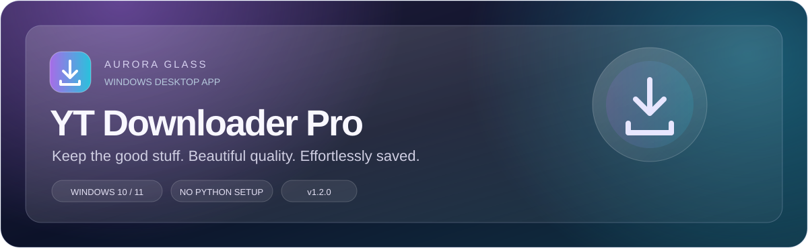

<p align="center">
  
</p>

<p align="center">
  <a href="https://github.com/Dilanga-Malshan/yt-downloader-tool/actions/runs/38680846841/artifacts/11948111280">
    
  </a>
</p>

<p align="center">
  <strong>Version 1.2.0 · Windows x64 · Python, FFmpeg and Deno included</strong><br>
  GitHub sign-in required to download the ZIP. Extract it and run <code>YT-Downloader-Pro-Setup.exe</code>.<br>
  <a href="#install-on-windows-no-python-required">Installation instructions</a> ·
  <a href="https://github.com/Dilanga-Malshan/yt-downloader-tool/actions/workflows/windows-installer.yml">All installer builds</a>
</p>

> **Ready to share:** Send the extracted **Setup.exe** to anyone using Windows 10/11 x64. They do not need a GitHub account to install it. This download expires on January 13, 2027; newer builds are available under **All installer builds**.

---

A modern Windows desktop GUI for downloading YouTube videos that you own or have permission to save.

## Highlights

<p align="center">
  
</p>

- Modern studio layout with a sidebar, dedicated link bar, settings and video preview
- Aurora Glass styling: purple-to-cyan gradient buttons, frosted-style panels and matching app icon
- Readable typography, soft borders and Dark / Light / System themes
- Scrollable panels and persistent download controls on smaller windows
- Paste + Analyze workflow
- Video thumbnail preview
- Video title, channel, duration and view count
- Dynamic quality detection
- MP4 video downloads
- MP3 audio extraction with selectable bitrate
- 4K / 1440p / 1080p / 720p / 480p / 360p support when available
- Progress percentage, speed and ETA
- Cancel download button
- Open output folder button
- FFmpeg status badge
- Graceful video fallback when FFmpeg is unavailable
- Background threads so the UI stays responsive

The desktop glass appearance uses frosted-style colour layers; it does not blur content behind the window.

## Requirements

- Python 3.11+
- FFmpeg recommended for high-quality video merging
- FFmpeg required for MP3 conversion

## Setup

Open PowerShell in the project folder.

```powershell
python -m venv .venv
.\.venv\Scripts\Activate.ps1
python -m pip install --upgrade pip
pip install -r requirements.txt
```

### Install FFmpeg on Windows

```powershell
winget install --id Gyan.FFmpeg -e
```

Close and reopen PowerShell/PyCharm after installation, then verify:

```powershell
ffmpeg -version
```

## Run

```powershell
python youtube_downloader.py
```

## If you already cloned an older version

Pull the latest code and update dependencies:

```powershell
git pull origin main
python -m pip install -r requirements.txt
python youtube_downloader.py
```

## Install on Windows (no Python required)

1. Open [Windows installer builds](https://github.com/Dilanga-Malshan/yt-downloader-tool/actions/workflows/windows-installer.yml).
2. Open the latest successful run and download **YT-Downloader-Pro-Windows-Installer** under Artifacts (GitHub sign-in required).
3. Extract the ZIP and run **YT-Downloader-Pro-Setup.exe**.
4. Follow the installer and launch from the Start menu or optional desktop shortcut.

Share the Setup.exe with other Windows 10/11 x64 users. They do not need Python, FFmpeg, Deno or a GitHub account to install the shared file. Internet is needed for downloading videos. Uninstall through Windows Settings > Apps. Downloads are saved in the chosen output folder and are not removed on uninstall.

The installer bundles Python, CustomTkinter, yt-dlp, FFmpeg/FFprobe and Deno (for YouTube JavaScript challenges). It installs for the current user without administrator rights. The installer is unsigned, so Windows may display an unknown publisher/SmartScreen message. Check the source and SHA256.txt before distributing.

## Build the installer

GitHub Actions builds the app on Windows on every push to main. You can also select **Run workflow** on the Windows installer workflow. The workflow launches the packaged app as a startup smoke test before compiling the Inno Setup installer. A successful startup does not verify downloading every YouTube video.

For local Windows builds, follow the commands in `.github/workflows/windows-installer.yml` with Python 3.12 and Inno Setup 6 installed. Bundled tool licenses are included beside the binaries in the installed `_internal` directory. FFmpeg build information and corresponding source are available from https://www.gyan.dev/ffmpeg/builds/.

## Update yt-dlp

For installed copies, rebuild and install a new Setup.exe to update the bundled downloader. The command below is for source installations only.

YouTube changes regularly. If extraction stops working, update yt-dlp:

```powershell
python -m pip install -U "yt-dlp[default]"
```

## Usage note

Only download media you own, that is licensed for download, or that you otherwise have permission to save. Platform terms and copyright rules may restrict downloading some content.
